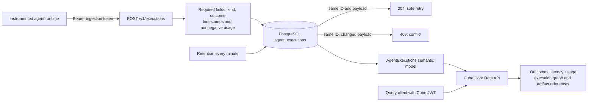
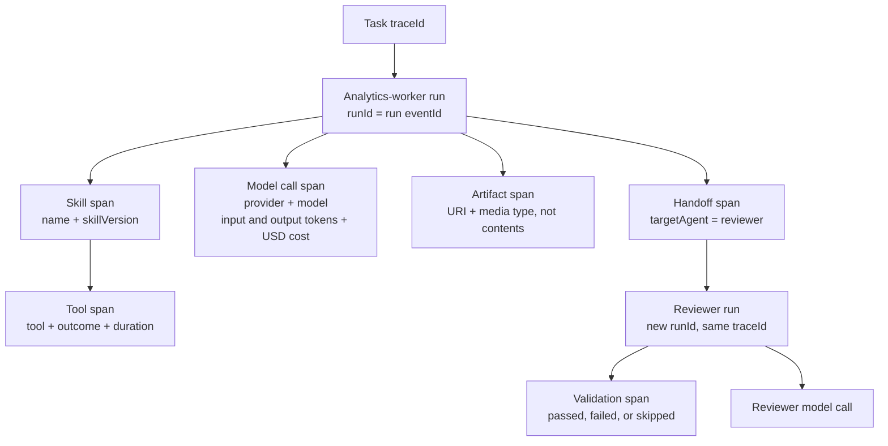

# Agent-execution telemetry

The optional `agent-ingest` process accepts **producer-reported completed spans**
and writes them to PostgreSQL. The `AgentExecutions` Cube model makes them
queryable alongside Kubernetes observations. This is telemetry, not a workflow
engine: it does not execute agents, discover their skills, or inspect private
chain-of-thought. Temporal and Kafka are not required.



The operator still reconciles Cube API/refresh/Cube Store workloads. The demo
supplies the ingestion Deployment, database, SQL initialization, and model
ConfigMap; these are not new CRD features.

## Execution anatomy

Each box below is a completed span with its own `eventId`. A trace groups the
whole task; each agent run has a separate `runId`. `parentId` expresses nesting
or delegation, even when records arrive out of order.



Runs record terminal status and latency. Usage belongs only to model-call spans,
so child calls and their parent runs cannot double-count tokens or cost. This
records observable work and results, not prompts or hidden reasoning.

## Run and verify on Kind

```bash
make kind-up
make kind-e2e
```

The second command submits a **synthetic** analytics-worker/reviewer trace with
all seven span kinds, then verifies its graph and exact Cube aggregates: nine
spans, two runs (one failed), one failed validation, 13,000 ms average run
duration, 160 input tokens, 48 output tokens, and $0.0168 reported cost. It also
checks authentication, invalid input, out-of-order delivery, duplicate retries,
and conflicting replay. Passed/skipped validation and cancelled-run controls
check that failure filters do not overcount. The check replaces the ingestion
pod and replays the same trace to verify database persistence and deduplication
across restarts. Unique trace IDs isolate each test from existing data.
It does not claim real agents performed the synthetic work.

The reusable `.github/workflows/e2e.yaml` runs this on fresh Kind clusters for
both Go and Kopf, then repeats setup and verification. PR/main CI and the
v0.2.0 release workflow both use it as a publication gate. CI additionally runs
Go PostgreSQL integration tests using `TEST_DATABASE_URL`.

`kind-up` generates a separate `agent-ingest` Secret, deploys a ClusterIP Service,
and restarts demo API/refresh pods to reload model files on reused clusters.
`kind-e2e` temporarily forwards ingestion to a random loopback port and closes
that forward on exit. The Cube API remains at `http://127.0.0.1:4000`.

## Producer contract

Post one JSON object to `POST /v1/executions`. Use
`Authorization: Bearer <AGENT_INGEST_TOKEN>`—unlike Cube's query API, which uses
the JWT **without** `Bearer`. The maximum request body is 64 KiB; unknown fields
and trailing JSON are rejected. A successful durable insert or identical retry
returns `204`. Invalid data returns `400`, bad credentials `401`, reused IDs
with different data `409`, and storage errors `503`.

Required common fields:

| Field | Meaning |
|---|---|
| `eventId` | Globally unique span ID; preserve it and the payload across retries. |
| `traceId` | Correlates a whole multi-agent task. |
| `runId` | Identifies one agent execution; use that run span's `eventId`. |
| `parentId` | Parent span ID; omit or use an empty string for a root run. |
| `tenantId`, `cluster`, `namespace` | Producer-reported attribution, **not authorization**. |
| `agent`, `name` | Agent identity and operation/skill/check name. |
| `kind` | `run`, `skill`, `tool`, `handoff`, `artifact`, `validation`, or `model`. |
| `status` | Terminal outcome: `succeeded`, `failed`, or `cancelled`. |
| `startedAt`, `endedAt` | RFC3339 timestamps, ordered; end time within retention and no more than five minutes ahead. |

Additional fields by kind:

| Kind | Required detail | Use |
|---|---|---|
| `run` | None | One terminal record per agent attempt; a retry attempt gets a new run ID. |
| `skill` | `skillVersion` | `name` identifies the skill; version pins what was used. |
| `tool` | `tool` | Tool identity; parent may reference a skill span. |
| `handoff` | `targetAgent` | Link the delegated agent's run to this handoff via `parentId`. |
| `artifact` | `artifactUri`, `artifactType` | Reference only; ingestion neither fetches nor stores artifact content. |
| `validation` | `validation`: `passed`, `failed`, or `skipped` | `name` identifies the check; `status` records its execution outcome. |
| `model` | `model`, `provider` | Optional nonnegative `inputTokens`, `outputTokens`, `costUsd` (default zero). |

`errorType` optionally classifies a failure without storing sensitive error text.
Usage/cost are accepted **only on model spans** to prevent summing both run totals
and their child model calls. Report each invocation once. Costs are reported USD,
not calculated billing. Nested spans overlap: use `averageRunDurationMs`, not a
sum of all span durations, for agent latency. `durationMs` is available on each
record.

Children can arrive before parents; the service does not enforce graph foreign
keys or resolve missing/cyclic references. Producers are responsible for valid
trace/run/parent relationships. Completed spans are immutable; there is no
in-progress/live-run state or update endpoint. Instrument the agent runtime to
emit terminal records on success, failure, and cancellation, and retry network
errors/503 with backoff using the **same** event ID and payload. Records pruned
by retention no longer have deduplication history.

Example tool span (replace timestamps with the current execution's times):

```json
{
  "eventId": "task-123-query-1",
  "traceId": "task-123",
  "runId": "task-123-analytics",
  "parentId": "task-123-cube-skill",
  "tenantId": "local",
  "cluster": "kind-cube-demo",
  "namespace": "cube-demo",
  "agent": "analytics-worker",
  "kind": "tool",
  "name": "analytics.usage",
  "tool": "cube-rest-load",
  "status": "succeeded",
  "startedAt": "2026-10-17T10:00:00Z",
  "endedAt": "2026-10-17T10:00:02Z"
}
```

For local manual submission, forward the Service in one terminal:

```bash
kubectl --context kind-cube-demo -n cube-demo port-forward --address 127.0.0.1 service/agent-ingest 8082:8082
```

In another, save your current execution JSON as `execution.json` and submit it:

```bash
AGENT_INGEST_TOKEN=$(kubectl --context kind-cube-demo -n cube-demo get secret agent-ingest \
  -o 'go-template={{index .data "token" | base64decode}}')
curl --fail --silent --show-error --max-time 15 \
  -H "Authorization: Bearer $AGENT_INGEST_TOKEN" \
  -H 'Content-Type: application/json' --data-binary @execution.json \
  http://127.0.0.1:8082/v1/executions
unset AGENT_INGEST_TOKEN
```

Do not enable shell tracing or log credentials. For in-cluster producers use
`http://agent-ingest.cube-demo.svc:8082/v1/executions` with the Secret injected
by your deployment. The full example producer/query checker is
[`demo/agent-executions.py`](../demo/agent-executions.py).

## Query the semantic model

Inspect `/cubejs-api/v1/meta` first. For example, query agent/skill outcomes:

```json
{
  "query": {
    "measures": ["AgentExecutions.count"],
    "dimensions": ["AgentExecutions.agent", "AgentExecutions.name", "AgentExecutions.skillVersion", "AgentExecutions.status"],
    "filters": [{"member": "AgentExecutions.kind", "operator": "equals", "values": ["skill"]}],
    "limit": 100
  }
}
```

Use `AgentExecutions.runs`, `failedRuns`, `failedValidations`,
`averageRunDurationMs`, `inputTokens`, `outputTokens`, and `costUsd` for summary
metrics. Filter `traceId` and request `eventId`, `runId`, `parentId`, `kind`,
`agent`, `name`, and `status` to reconstruct a task. Artifact references, tool,
handoff target, validation outcome, provider, model, and skill version are
dimensions, not opaque unqueryable logs.

## Standalone operation and limits

Run the newly built Go image with argument `agent-ingest`; it needs no Kubernetes
API permissions. Set `DATABASE_URL` and `AGENT_INGEST_TOKEN` (at least 32 characters).
Optional `AGENT_INGEST_ADDRESS` defaults to `:8082`; `RETENTION` defaults to `168h`
and must be positive. Tables/indexes are initialized on startup; the database
user therefore needs DDL and DML privileges. Expired records are pruned every
minute. `GET /readyz` checks the database without credentials.

This is a trusted local/demo ingestion boundary with one shared credential.
**It does not provide OIDC authentication, per-tenant isolation, row-level Cube
authorization, or automatic Kafka/Temporal/OpenTelemetry adapters.** Before
multi-tenant/external use, enforce authenticated tenant identity and query
filtering server-side, use TLS and network restrictions, separate database
write/read roles, rotate credentials, and add rate limits. A `tenantId` query
filter alone is not a security boundary. Do not submit credentials, prompts,
private reasoning, signed artifact URLs, or sensitive contents in string fields.
The published v0.1.0 image predates this mode; use a build from these changes
until a new release is published.
