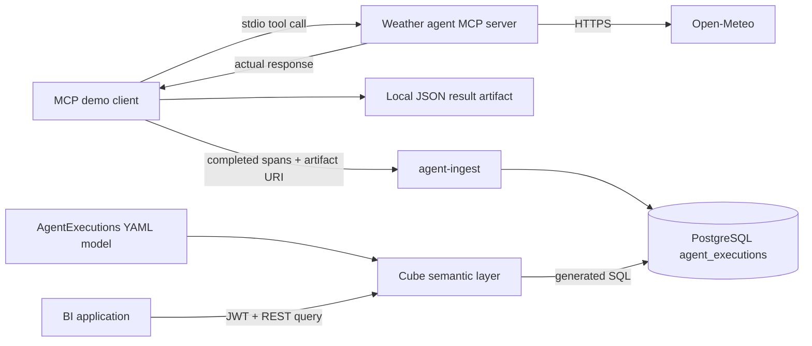

# Real MCP weather execution and BI queries

The [`mcp_execution.py`](../demo/mcp_execution.py) demo starts a stdio MCP
server, discovers its tools, invokes one, saves its actual response, submits
completed spans, and checks that Cube returns the same execution graph.
It can run an existing MCP tool server without copying its implementation into
this repository. Only run trusted server commands: they execute on your host.

## What was actually demonstrated

On October 17, 2026, the separate platform weather agent's `weather_current`
tool fetched live Open-Meteo conditions for Reykjavik. It ran the existing
Python agent handler through its new standalone MCP entrypoint, **on the host**,
not through the platform's Kafka workers or an LLM. The result contained:

```json
{
  "location": "Reykjavik",
  "country": "Iceland",
  "current": {
    "time": "2026-10-17T20:45",
    "temperature_2m": 9.7,
    "relative_humidity_2m": 91,
    "wind_speed_10m": 45.0
  }
}
```

Units were °C, %, and km/h respectively. These are captured observations, not
current weather or a benchmark. PostgreSQL and Cube independently returned:

| Agent | Spans | Runs | Failed runs | Average run ms | Input/output tokens | Reported USD |
| --- | ---: | ---: | ---: | ---: | ---: | ---: |
| weather | 3 | 1 | 0 | 2160.206 | 0 / 0 | 0 |

The three spans were a successful `run`, `tool` (`weather_current`), and
`artifact` (JSON result reference). Zero usage is intentional: no model ran.
This does not claim automatic collection of other agents, skills, delegation,
or model calls. Those require corresponding instrumentation in their runtimes.

## Where the data lives



- **PostgreSQL:** execution identities, parent links, outcomes, timestamps,
  computed duration, reported usage, and typed detail fields in `payload` JSONB.
- **Local artifact:** the actual weather response. Only its URI and media type
  enter ingestion; neither ingestion nor Cube fetches the file.
- **Cube model:** version-controlled measures and dimensions in
  [`AgentExecutions.yml`](../demo/kind/model/AgentExecutions.yml). Cube compiles
  semantic queries into SQL; it does not create a SQL table for every measure.
- **Pre-aggregations:** none are declared in this demo. The verified query's
  `/sql` response reported `external: false` and `preAggregations: []`.
  Deploying Cube Store alone does not demonstrate rollup acceleration.

Temperature/humidity are **not** normalized into the execution table. For
weather-domain BI, separately persist observations with station/location,
observation time, units, and provenance, then supply a dedicated Cube model.
The current BI examples analyze agent work, not weather trends.

## Reproduce with your weather agent

Install the client dependency in an activated Python environment:

```bash
python -m pip install -r demo/requirements-mcp.txt
```

For the separate platform checkout, install its optional `mcp` extra and use
the Python environment containing that agent. The operator does not download
or publish the private platform source. From this repository:

```bash
PLATFORM=/absolute/path/to/agentic-kubernetes-platform
export PYTHONPATH="$PLATFORM/src:$PLATFORM/agents/weather/src"

python demo/mcp_execution.py --execute-only --output /tmp/weather-demo -- \
  "$PLATFORM/.venv/bin/python" -m weather_agent.mcp
```

This invokes the real tool and writes uniquely named `.result.json` and
`.executions.json` files. Execution-only mode explicitly reports
`"cubeVerified": false`; it does not pretend that records were ingested.
For a forecast, add `--tool weather_forecast --arguments
'{"location":"Reykjavik","days":3}'` before `--`.

For full verification, first run the operator's Kind stack. Forward ingestion
in a separate terminal:

```bash
kubectl --context kind-cube-demo -n cube-demo port-forward \
  --address 127.0.0.1 service/agent-ingest 8082:8082
```

In the client terminal, configure the ingestion credential and a short-lived
Cube query JWT. Use the [REST token example](../README.md#use-the-cube-core-rest-api),
with context `kind-cube-demo` and namespace `cube-demo` instead of `cube`:

```bash
export AGENT_INGEST_URL=http://127.0.0.1:8082
export AGENT_INGEST_TOKEN=$(kubectl --context kind-cube-demo -n cube-demo \
  get secret agent-ingest -o 'go-template={{index .data "token" | base64decode}}')
export CUBE_CORE_URL=http://127.0.0.1:4000
# Set CUBE_CORE_TOKEN using the short-lived JWT example linked above.
python demo/mcp_execution.py --output /tmp/weather-demo -- \
  "$PLATFORM/.venv/bin/python" -m weather_agent.mcp
unset AGENT_INGEST_TOKEN CUBE_CORE_TOKEN
```

Success reports `"cubeVerified": true` with the actual Cube rows. Failed tool
calls produce failed run/tool spans and a nonzero exit; a tool that was never
invoked does not get a fabricated tool span. Artifact files are not uploaded to
shared storage: a `file:` URI is useful locally, not a portable BI download link.
The child MCP server does not receive the ingestion token or Cube JWT through
the demo's environment forwarding. Arguments and returned artifacts may still
contain sensitive data; use public weather inputs for demonstrations.

## Inspect persisted SQL and query semantic BI metrics

The captured trace ID was `mcp-bb768566719a424aba21b58af46a6c8b`. Replace it with
the new ID printed by your run. Records expire under configured retention.
The following PostgreSQL queries are for authorized database auditing, **not**
a reason to give agents direct database credentials.

```sql
SELECT event_id, parent_id, kind, status, duration_ms,
       payload->>'tool' AS tool,
       payload->>'artifactUri' AS artifact_uri
FROM public.agent_executions
WHERE trace_id = 'mcp-bb768566719a424aba21b58af46a6c8b'
ORDER BY started_at, event_id;

SELECT agent_name,
       count(*) AS spans,
       count(*) FILTER (WHERE kind = 'run') AS runs,
       count(*) FILTER (WHERE kind = 'run' AND status = 'failed') AS failed_runs,
       avg(duration_ms) FILTER (WHERE kind = 'run') AS average_run_ms,
       sum(input_tokens) AS input_tokens,
       sum(output_tokens) AS output_tokens,
       sum(cost_usd) AS cost_usd
FROM public.agent_executions
WHERE trace_id = 'mcp-bb768566719a424aba21b58af46a6c8b'
GROUP BY agent_name;
```

The equivalent Cube REST query below returned the same values in the table
above. Counts/decimals can be represented as JSON strings by Cube:

```json
{
  "query": {
    "dimensions": ["AgentExecutions.agent"],
    "measures": [
      "AgentExecutions.count", "AgentExecutions.runs",
      "AgentExecutions.failedRuns", "AgentExecutions.averageRunDurationMs",
      "AgentExecutions.inputTokens", "AgentExecutions.outputTokens", "AgentExecutions.costUsd"
    ],
    "filters": [{
      "member": "AgentExecutions.traceId", "operator": "equals",
      "values": ["mcp-bb768566719a424aba21b58af46a6c8b"]
    }]
  }
}
```

Save it as `query.json`, then execute it or inspect Cube's generated SQL:

```bash
curl --fail --silent --show-error --max-time 95 \
  -H "Authorization: $CUBE_CORE_TOKEN" -H 'Content-Type: application/json' \
  --data @query.json "$CUBE_CORE_URL/cubejs-api/v1/load" | jq .
curl --fail --silent --show-error --max-time 95 --get \
  -H "Authorization: $CUBE_CORE_TOKEN" \
  --data-urlencode "query=$(jq -c .query query.json)" \
  "$CUBE_CORE_URL/cubejs-api/v1/sql" | jq '.sql.sql'
```

Handle `Continue wait` with bounded retries, as the demo does. For a daily BI
dashboard, replace the trace filter with a `timeDimensions` entry using
`AgentExecutions.endedAt`, `granularity: "day"`, and an explicit date range;
keep `AgentExecutions.agent` as the grouping dimension. Add dimensions such as
`tool`, `status`, or `artifactUri` for drill-down rather than summing overlapping
span durations as total agent latency.

This demonstrates REST-based BI integration. It does not configure a dashboard
product, expose Cube's PostgreSQL-compatible SQL API, or enforce tenant policies.
Shared-token demo attribution is not authorization; configure server-side
policies before external or multi-tenant access.

## Automated checks

Pre-commit/PR CI run MCP subprocess tests for success, failure, missing tools,
credential separation, ingestion, and rejection of corrupted Cube results.
Both controller Kind E2E jobs also execute the MCP-to-ingestion-to-Cube path.
Public CI uses an explicitly labelled deterministic weather fixture, **not**
the private agent or live Open-Meteo. The private agent's own MCP tests exercise
its real handler with deterministic provider responses; the live result above
was separately verified against Open-Meteo and PostgreSQL/Cube.
